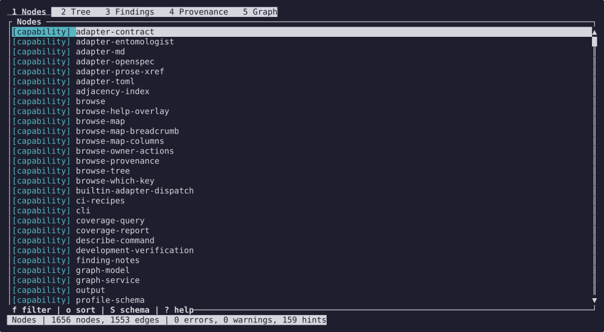

# Lattice Auditing & Tracing Tool

Lattice (`latt`) checks and queries the records a repository keeps in its own files
(requirements, specs, tests, issues) and the links between them. It reads them where
they live, in the format they already use: an **adapter** for each format turns the
files into records and links, and a YAML **profile** declares which kinds of record
exist, what their IDs look like and which rules to check.

It reports dangling references, requirements with no recorded test link, invalid
attributes and rows it could not read, each at its file and line. Developers, AI agents
and CI jobs run the same check as the files change and get the same answer.

Use Lattice when records span many files, when rows hold syntax a text
search misreads (a commented-out row, a template row in a code block, an ID named in
prose), or when the same check runs on every commit. For a small register and a one-off
question, reading the files may be quicker. A missing test link means the register
records none; whether a test exists elsewhere, or passes, lies outside what Lattice reads.

Three design rules hold throughout:

- **Your files stay the authority.** Lattice reads them afresh each run and stores
  nothing; edits go through your editor or the register's own tool.
- **Your vocabulary lives in the profile.** A new vocabulary needs a profile, no code.
- **Unreadable input is reported.** An unparsable row becomes a `PARSE_ERROR` at its line.

Beside the CLI come a terminal browser and a Rust library.



## How it works

The profile's `adapter:` block picks the adapter and tells it where to look. The adapter
hands the core a JSON document of records and links, with a finding for anything it
could not read. The core builds the graph from that document and checks it against the
profile, the same way for every format and register. A new format needs a new adapter,
and leaves the core alone.

## Three ways to use it

| Interface | For | What you get | Start with |
|---|---|---|---|
| `latt` CLI | people at a terminal, CI jobs, scripts and AI agents | findings with file and line, queries, a three-valued exit code, and `--format json` | [cli.md](docs/cli.md) |
| `latt browse` TUI | people exploring a register | the graph in the terminal: follow edges, jump from a finding to its row, hand a node to your editor | [browse.md](docs/browse.md) |
| `latt-core` library | Rust applications that hold a register in memory | the same validation and queries as a function call, with no file or network I/O | [embedding.md](docs/embedding.md) |

**For agents.** An agent drives the CLI like a script does, and reads the exit code
first: `0` no error-severity findings (warnings may still print), `1` error-severity
findings, `2` Lattice could not run. `--format json` is the output whose shape is a
public surface, and [json.md](docs/json.md) lists every key. A release install carries
the documentation beside the binary, so an agent can read it there. Two files prime an
agent before it starts:

- [`AGENTS.md`](AGENTS.md) points an agent at the skill, the core docs and the rules for
  using Lattice.
- [`skills/latt/`](skills/latt/SKILL.md) is an agent skill: the commands, what each exit
  code means, how to read a finding and how to write a profile. Copy the directory into
  your agent's skills directory (for Claude Code, `~/.claude/skills/`).

**In CI.** A job or hook runs the same `latt validate` line you run by hand, and decides
on the exit code: `0` passes, `1` fails on error-severity findings, and `2` flags a
broken setup, such as a profile that will not load. [ci.md](docs/ci.md) has a recipe for
each way to gate:

- a pre-commit hook and a GitLab CI job that stop only when Lattice cannot run;
- error and strict gates, a JSON check, a merge-request report, and a profile test that
  pins your profile's findings on a fixture register.

## What it does

**Adapters.** One for each format; these ship with Lattice:

| Register | Adapter |
|---|---|
| Markdown tables | [`md`](docs/adapters.md#markdown-table-adapter) (built in) |
| TOML array-of-tables | [`toml`](docs/adapters.md#toml-adapter) (built in) |
| `§` cross-references in prose | [`prose-xref`](docs/adapters.md#prose-cross-reference-adapter) (built in) |
| [entomologist](https://github.com/Taproot-Manufacturing-Syndicate/entomologist) issues | [`entomologist`](docs/adapters.md#entomologist-adapter) |
| OpenSpec specs and the tests that cite them | [`openspec`](docs/adapters.md#openspec-adapter) (Python) |

For any other format, you can write an adapter: a program in any language that prints one
JSON document ([adapters.md](docs/adapters.md#writing-your-own-adapter)).

**Validation.** A YAML profile declares the node kinds, their ID patterns and attrs, and
which kinds may point at which. `latt validate` reports:

- broken structure: a dangling reference (`VACANCY`), an ID of the wrong shape, an edge
  between kinds that may not be linked;
- gaps in traceability: a requirement no test verifies (`COVERAGE`), a node nothing
  points at or that points at nothing;
- bad data: a missing or mistyped attr, a value outside its enum, a failed cross-field
  rule;
- unreadable input: a malformed row or file, reported at its line as `PARSE_ERROR`.

Each finding has a default severity; your profile can change it, short of promoting a hint.

**Queries.** `latt query` finds what a node reaches, the path between two
nodes, the orphans, the counts, or what changed between two git revisions. `latt fuse`
checks references across registers in several repositories.

## Install

Releases are on [GitHub](https://github.com/jonelay/lattice/releases/tag/v0.8.0), for Linux
on x86_64 and aarch64. A release carries `latt` and the `latt-adapter-<name>` programs as
single binaries, one set per architecture, and GitHub's source archive of the tag, which
holds `profiles/`, `adapters/` and `docs/`.

1. Unpack the source archive.
2. Put your architecture's binaries in a `bin/` beside `profiles/`, named `latt` and
   `latt-adapter-<name>` without the architecture suffix.
3. Put that `bin/` on your PATH.

That directory is a release install.

To build from a checkout, install [rustup](https://rustup.rs); the first `cargo` command
fetches the pinned toolchain. Then:

```sh
cargo install --locked --path crates/latt
```

This puts `latt` and `latt-adapter-entomologist` in `~/.cargo/bin`. The `md`, `toml` and
`prose-xref` adapters are built into `latt`. The entomologist adapter runs `git`, which
must be on your PATH.

The Python programs, the `openspec` adapter and the `latt-suggest` sidecar, need Python
3.12 or later. They stay in `adapters/` and run with `python3`; name them by path, as in
`--adapter /path/to/lattice/adapters/openspec`.

## Quick start

Lattice's own repository is a register: its specs state 367 requirements in
`### Requirement:` headings, and its tests cite the requirement they verify in a comment
such as `// Requirement: cli/Exit codes`. With `latt` on your PATH, and Python 3.12 or
later for the `openspec` adapter, clone the release and validate it:

```sh
git clone --branch v0.8.0 https://github.com/jonelay/lattice
cd lattice
latt validate --profile profiles/openspec.yaml --adapter adapters/openspec --target . --format plain
```

The profile, `profiles/openspec.yaml`, asks for a `verifies` edge into every requirement.
The 158 requirements without one print as `COVERAGE` hints, each at its spec line. Hints
show on every run and gate nothing, so the run exits `0`. A last line on stderr says what
the run read: 98 files, 367 requirements, 1249 tests.

Ask which tests verify a requirement:

```sh
latt query reached-by 'cli/Exit codes' --edge-kind verifies \
    --profile profiles/openspec.yaml --adapter adapters/openspec --target .
```

`latt browse` with the same `--profile`, `--adapter` and `--target` opens the register:
follow an edge from a requirement to its tests, or jump from a finding to its line.

To describe a register of yours, [profiles.md](docs/profiles.md#a-first-profile) starts
with a profile for a Markdown table.

## Commands

| Command | Answers |
|---|---|
| `describe` | What does the profile declare, and what did the adapter read under it? |
| `validate` | Where does the register break the profile's rules? |
| `trace` | Every node, with its edges and findings |
| `summary` | How many nodes are in each status? |
| `coverage` | Per kind, how many nodes have incoming and outgoing edges? |
| `query` | Reachability, paths, orphans, counts, a file's declarations, a diff between revisions |
| `fuse` | Do the references between several registers resolve? |
| `browse` | Interactive navigation of nodes, edges and findings |
| `show` | What profile document does the adapter receive? |
| `adapter` | What does a built-in adapter produce? |

Every command takes `--help`. [cli.md](docs/cli.md) owns the details: flags, output
formats and exit codes.

## Documentation

| Page | Contents |
|---|---|
| [cli.md](docs/cli.md) | Commands, output formats and exit codes |
| [profiles.md](docs/profiles.md) | A first profile, then the schema: kinds, IDs, edges, validations |
| [adapters.md](docs/adapters.md) | Each shipped adapter's configuration, and writing your own |
| [browse.md](docs/browse.md) | The terminal browser: views, keys and actions |
| [ci.md](docs/ci.md) | Pre-commit hook and CI job recipes |
| [json.md](docs/json.md) | Every key of each command's `--format json` output |
| [fuse.md](docs/fuse.md) | References across several registers |
| [embedding.md](docs/embedding.md) | The Rust library interface |
| [glossary.md](docs/glossary.md) | Terms the docs use |
| [references.md](docs/references.md) | Published methods Lattice follows |
| [CHANGELOG.md](CHANGELOG.md) | Changes per release, with migration notes |

To work on Lattice itself, see [CONTRIBUTING.md](CONTRIBUTING.md).

## License

Licensed under either of the [Apache License, Version 2.0](LICENSE-APACHE) or the
[MIT license](LICENSE-MIT), at your option.

Unless you explicitly state otherwise, any contribution intentionally submitted
for inclusion in the work by you, as defined in the Apache-2.0 license, shall be
dual licensed as above, without any additional terms or conditions.
