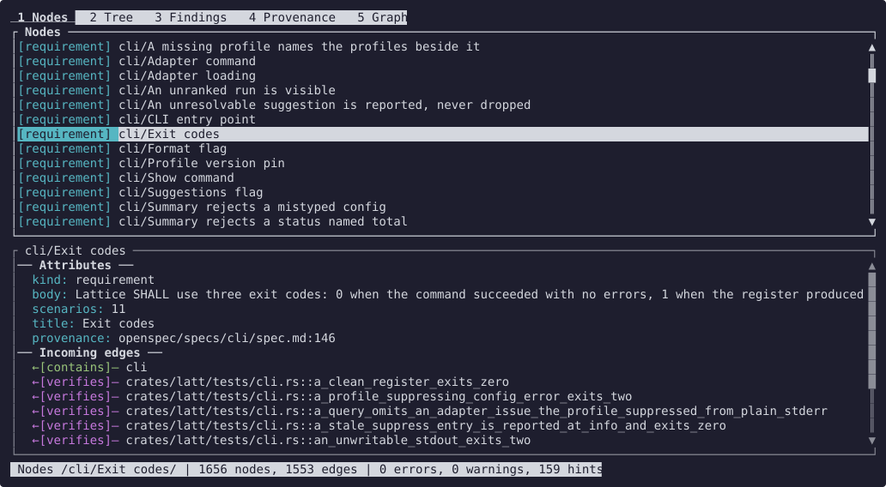
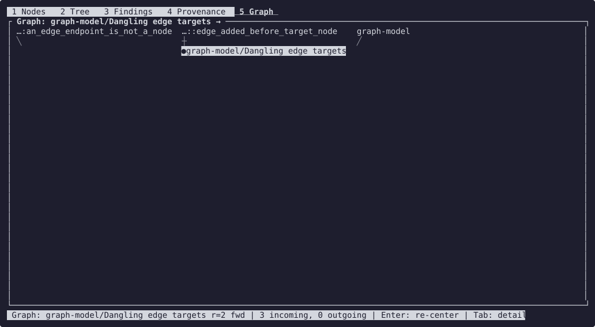
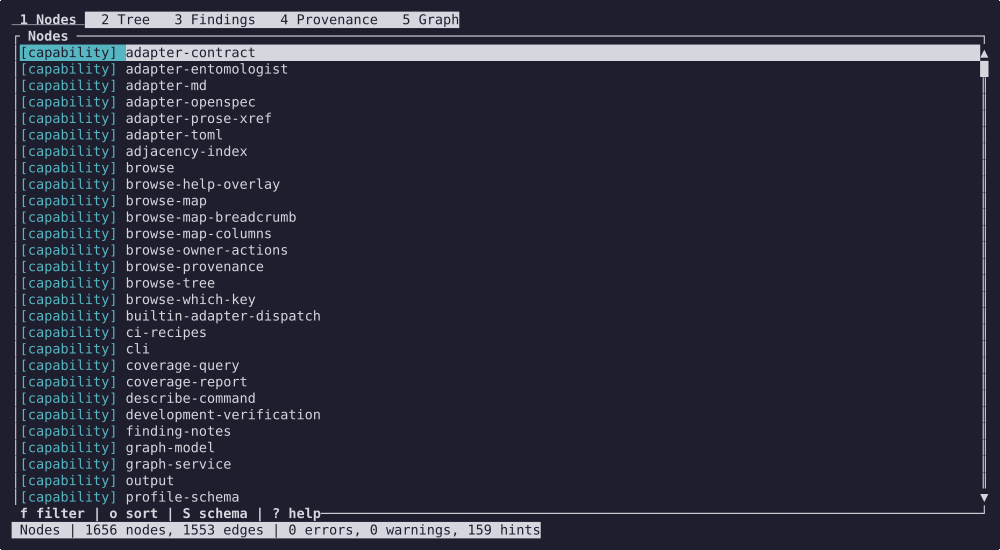

# Browse

`latt browse` opens a register in the terminal: every node, its edges in both
directions, and the findings on it, with the same profile and adapter the other commands
take. For automation, use `trace` or `query` with `--format json` ([cli.md](cli.md)).

The images on this page show Lattice's own register, read as the README's quick start
reads it: the requirements its specs state and the tests that cite them.



## Starting it

`browse` is behind the `tui` build feature, which is on by default: `cargo build --release`,
or `cargo install --locked --path crates/latt`. A build with `--no-default-features` has no `browse`.

```sh
latt browse --profile /path/to/lattice.yaml --target /path/to/repo
```

It takes `--profile`, `--adapter`, `--target`, `--strict` and `--filter` like the other
commands, but not `--format`. It exits 2 without starting when stdout is not a terminal
or `TERM=dumb`. Outside a UTF-8 locale it draws borders and arrows in ASCII.
`--glyphs ascii|unicode` overrides that choice, for example on a terminal that draws
those glyphs double-width. `NO_COLOR` turns colour off.

## Views

The number keys switch views; `?` lists every key for the view you are in.

| Key | View | Shows |
|---|---|---|
| `1` | Nodes | every node grouped by kind, with its summary attr; `S` switches to the schema, the kinds with their counts and the edges the profile allows but no node uses |
| `2` | Tree | what the selected node reaches, depth first; `Space` expands, `-` collapses, `d` turns the direction round |
| `3` | Findings | every finding, by severity or kind; `Enter` goes to the finding's node |
| `4` | Provenance | the register drawn as lanes, with the git history of the selected node's source line |
| `5` | Graph | the selected node's neighbourhood, layered ([references.md](references.md) names the method), with the cursor on the centre; `Enter` re-centres on a neighbour, `+`/`-` widen and narrow it. A neighbour's ID longer than 32 characters shows as `…` and its tail, and a wide graph scrolls sideways to keep the cursor's node in sight |



## Moving around

`j`/`k` or the arrows move, `g`/`G` go to the top and bottom, and `/` searches (`n`/`N`
for the next and previous match). `Enter` opens a node's detail; `Tab` moves into it, and
`Enter` on an edge row follows the edge. `q` goes back one step and quits from the top;
`Q` and `Ctrl-C` quit at once. `f` filters by kind, and `o` switches a list between the
profile's kind order and worst finding first. `.` shows suppressed findings, which the
status line's counts leave out.



## Acting on a node

Browse never writes the register. It hands the selected node to a program that can:

- `e` opens the node's source in `$EDITOR` at its line, or runs the profile's `edit`
  action for that kind. A source at line 0, such as a TOML record in `directory` mode,
  opens at the top of its file. For a source that is not a file in the working tree (an issue on
  a git branch, an API record), or a finding about the profile as a whole, the status line
  says so instead.
- `c`, `s`, `a` and `t` run the profile's `comment`, `state`, `assign` and `tag` actions,
  and `!` lists every action for the node ([profiles.md](profiles.md), `actions`).
- `A` on a finding opens the profile's notes file at that finding's entry
  ([profiles.md](profiles.md#finding-notes)).
- `p` previews the source file.

After an edit, `r` reloads the register and `R` reloads the profile and the register;
the view, cursor and searches carry over by node ID.
